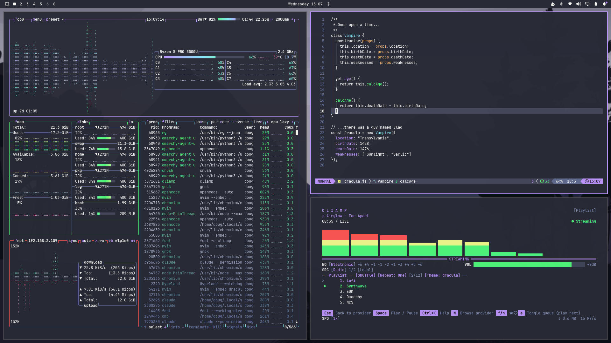

# Orlok for [Omarchy](https://omarchy.org)

> A dark theme for [Omarchy](https://omarchy.org).
>
> This Orlok Theme for Omarchy focuses on providing a cohesive and visually appealing setup for my environment.

This theme is primarly for [Omarchy](<https://omarchy.org>) and is a slightly modified dracula theme.



## Config

### Icons theme

- Yaru
- Yaru-blue
- Yaru-dark
- Yaru-magenta
- Yaru-olive
- Yaru-prussiangreen
- Yaru-purple
- Yaru-red
- Yaru-sage
- Yaru-wartybrown
- Yaru-yellow

## Installation

All instructions can be found here. But do not run the command below.

```bash
omarchy theme install https://github.com/NotDracula/ForOmarchy
```

## License

[MIT License](./LICENSE)
